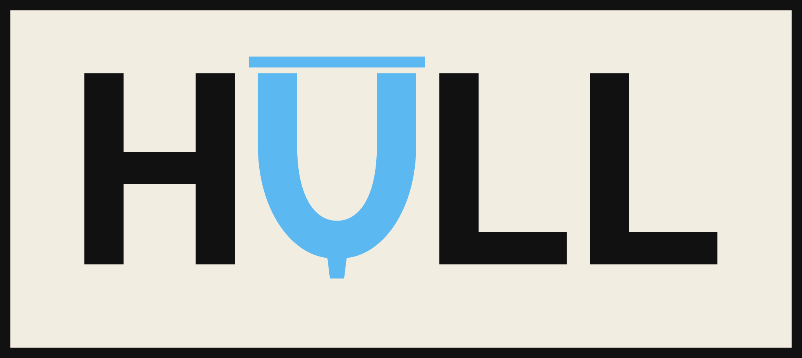
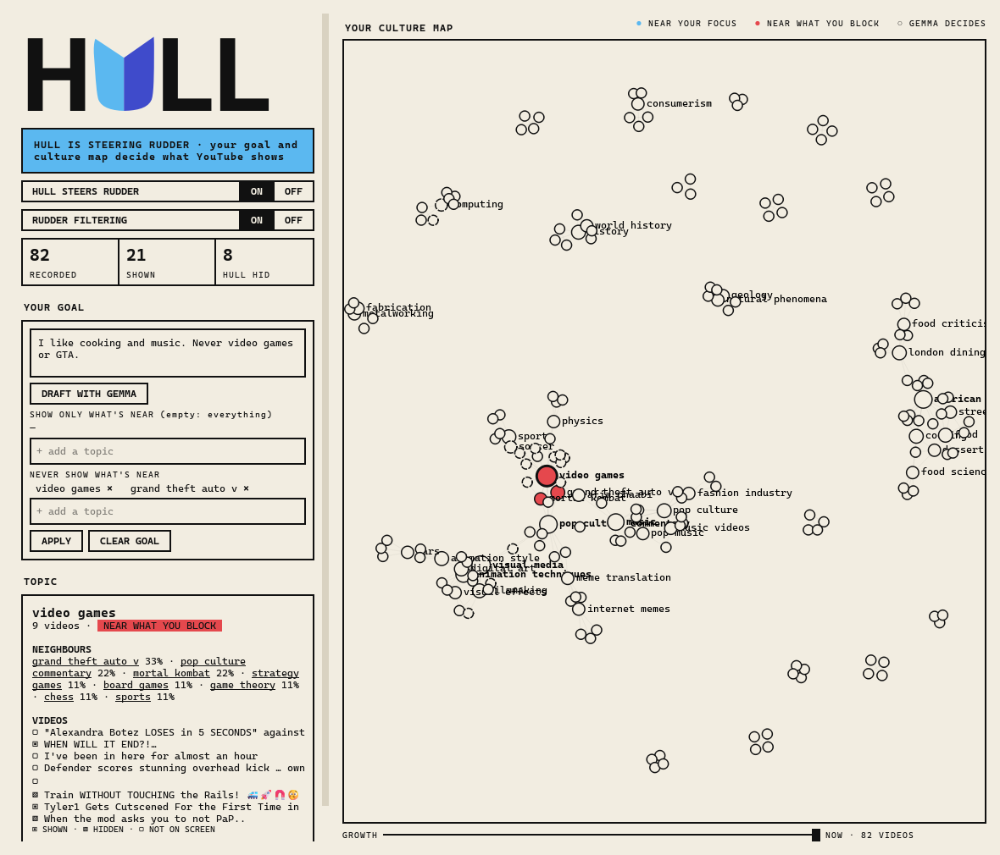
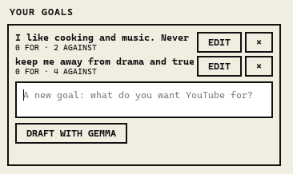
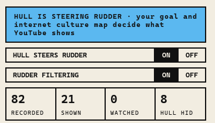
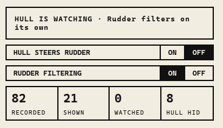

Hull: Your own internet culture graph, locally computed to drive a more comprehensive Rudder Youtube filtering system via its gRPC API.

Problem case: Rudder lets you choose what you don't want to see. But a list of words is never long enough. You block "GTA" and Youtube shows you "Los Santos". You hide a video and it comes back next week, or someone uploads it again. A student sits down to learn Bayesian statistics, and the home page fills up with games, cooking and music, because those keep people watching. Youtube does not know what you came for, and it has no way to ask.

Solution: Hull is the ship under the Rudder. It runs on your own computer, and nothing leaves it. Gemma, a small AI model, reads every video Rudder sees, looks at its picture, and writes down what it is about. Hull puts every video on a map of everything you watch: your internet culture. Things that belong together sit together, so games end up near games and cooking near cooking. The map grows every day you use it. Its colours show what your goals do: blue where videos get through, red where they don't. Click any part of it to see what Hull does there.

Then you tell Hull what you want, in your own words: "I'm learning Bayesian statistics. Nothing else." Gemma goes through every topic on your map and sorts it: for your goal, against it, or neither. You can change any of them before you press Apply. Hull lets through the videos near what's for, and hides what's against, even the ones you never thought to block. You can keep as many goals as you like at once. And it shows you each video only once, copies uploaded under a new name included.

Hull learns your taste too. Every 👍 and 👎 you give in Rudder goes to Hull, and it hides new videos that are really like the ones you disliked, and topics you keep disliking.

Hull also listens. When you watch a video, Rudder quietly reads its English subtitles, without showing them unless you press CC. Gemma learns what the video really talks about, so your map is built from what you actually watch.

 

You are always the captain. One switch puts Hull in charge of Rudder, and one switch turns Rudder off. Nothing on your screen jumps when you flip them; the change starts with the next videos. Hull says in big letters whether it is steering, and Rudder's own popup shows the Hull symbol and Hull's numbers too. Close the window and Hull keeps sailing from the tray.

The reason it works is the same as Rudder's: a viewer who only ever clicks what they came for is a clear signal. Youtube's own algorithm learns from it, and starts bringing more of the right videos by itself. Hull just makes sure that signal is the one you meant to send.

Happy Sailing.

---

**Start it:**
1. Install [Rudder](https://github.com/Hassleware/rudder) and start its bridge.
2. Install [Ollama](https://ollama.com), then `ollama pull gemma4:e4b` and `ollama pull embeddinggemma`.
3. Get **Hull.exe** from [the latest release](https://github.com/Hassleware/hull/releases/latest) and run it. It keeps its settings (`hull.toml`) and your data next to itself.

   Or, with Python 3.11 or newer: in this folder, run `pip install -e .`, then `python -m hull`.

How it all works: [docs/how-it-works.md](docs/how-it-works.md).
